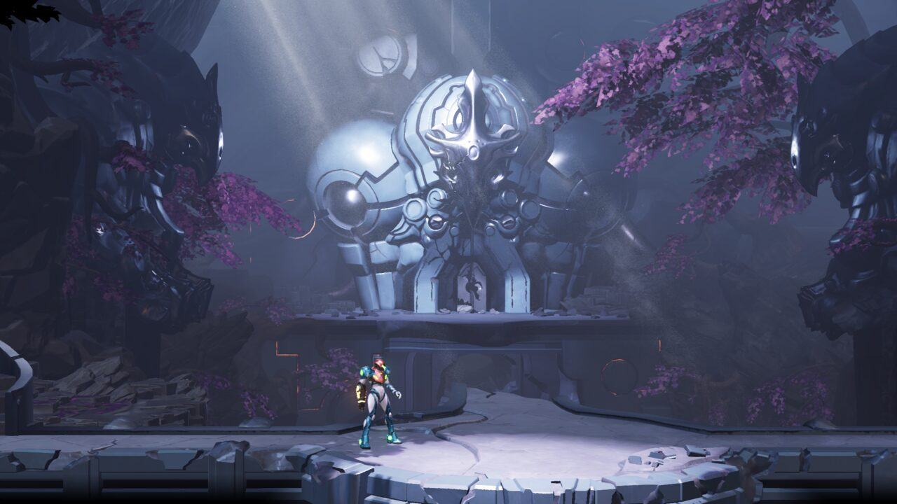
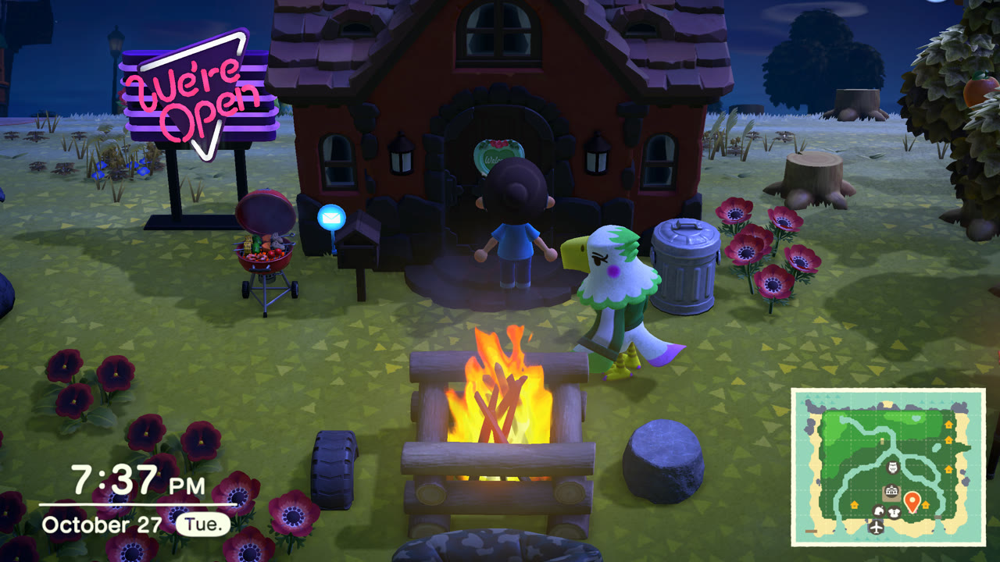

# nx

A static recompilation engine for **Nintendo Switch** games, producing native **macOS** applications (Apple Silicon,
Metal). A game's own ARM64 code is translated to C ahead of time and compiled for your Mac; the Switch's operating
system, GPU API (NVN), audio, video decoding and input are replaced by host implementations. It is not an emulator:
the game runs as a native program.

| Game | Versions | State |
|---|---|---|
| **Metroid Dread** | 1.0.0, 2.1.0 | Playable from the opening to the last area (54 save checkpoints checked) |
| **Animal Crossing: New Horizons** | 1.0.0, 2.0.7 | Playable: the intro, the island, shops, flights, photos; saves from a Switch load |

| Metroid Dread | Animal Crossing: New Horizons |
|---|---|
|  |  |

<sub>Running in nx on an M4 Pro Mac. Metroid Dread and Animal Crossing: New Horizons © Nintendo.</sub>

Any other game boots through the same engine without a profile (its title ID and code come from its own files); a
profile under `games/<id>/` adds what a game needs on top (see [Adding a game](#adding-a-game)).

> [!IMPORTANT]
> **No Nintendo files are included in this repository** - no game code, no assets, no keys, no generated C. You need
> your own legally obtained copies of the games. The game code is recompiled on your machine from your own files.
> Instructions for dumping games or keys will not be provided.

> [!NOTE]
> This project was built almost entirely with AI (Anthropic's Claude, through Claude Code), directed and reviewed by a
> human. It is an early, experimental work in progress: expect bugs.

## Status

- **Metroid Dread** boots, plays its movies, runs the title screen, save files and the whole game's areas, and is
  playable with a gamepad or the keyboard at your display's refresh rate (120 fps on a ProMotion Mac). Every one of
  the 832 unique shader stages it ships translates to Metal and compiles. Checked against a ladder of 54 save files
  spanning the whole game: each loads and runs minutes of scripted play without crashing and renders correctly
  (`tools/checkpoints.sh`). Nobody has finished the game on it yet.
- **Animal Crossing: New Horizons** runs the whole intro (Tom Nook's questions, typing your name, the character
  creator, the island choice), the opening movie and the island: houses, shops, Resident Services, the airport and
  mystery-island flights, the NookPhone and its camera (photos saved as PNGs), day and night. It runs at its own 30 fps,
  shown at 60 or 120 with frame generation, at up to 4K. Saves from a Switch load as their resident's account
  (`tools/acnh_save.py`). Checked with `tools/acnh_saves.sh`.
- **In-game menu** (F1 or Esc, or Minus + Plus on a controller): saves and backups, the game's date and time, video,
  audio and controls. See [Settings and the menu](#settings-and-the-menu).
- **Game updates** are applied when extracting (`--update`): the update's code and its romfs patch over the base
  game's.
- Not done: online features, Linux and Windows (the Vulkan backend from LASRecomp is there but has not been built).

See [PLAN.md](PLAN.md) for the design, the full status and the known problems.

## Building

Requirements: an Apple Silicon Mac, Xcode command line tools, [Homebrew](https://brew.sh) `llvm` (clang), `sdl3`,
`ffmpeg`, `zstd`, Python 3 and [Bun](https://bun.sh) (only for extracting games).

```sh
brew install llvm sdl3 ffmpeg zstd
python3 -m venv .venv && .venv/bin/pip install unicorn capstone lz4
```

1. **Extract your game files** into `data/<name>/` (any name; it is what you pass as `GAME` below). Put your own
   `prod.keys` (and `title.keys` if you have one) in the repository folder or next to the dump:

   ```sh
   bun extract.mts "Metroid Dread.xci" data/dread
   bun extract.mts "Metroid Dread.xci" data/dread-2.1.0 --update "Metroid Dread Update 2.1.0.nsp"
   bun extract.mts "Animal Crossing New Horizons.nsp" data/acnh
   bun extract.mts "Animal Crossing New Horizons.nsp" data/acnh-2.0.7 --update "Animal Crossing New Horizons v2.0.7.nsp"
   ```

   Each writes `exefs/` (the game code: `main`, `sdk`, `subsdk0`, ...) and `romfs/` (the game data). XCI (cartridge)
   and NSP (eShop) dumps both work; `--update` applies an update NSP on top. `data/` can be a symlink to another disk.
   All of these stay out of git (`.gitignore`).

2. **Recompile the game code** into C (`generated/<name>/`, under a minute), then **build** the app and the game's
   library (`build/nx`, shared by every game, and `build/<name>/game.dylib`; a few minutes the first time):

   ```sh
   make gen GAME=acnh
   make -j10 GAME=acnh
   ```

3. **Optional, recommended: prebuild the shaders** (`make corpus GAME=acnh`, see [Shaders](#shaders)).

4. **Play:**

   ```sh
   ./build/nx data/acnh
   ```

   The app picks the game library built for those game files. Saves go to `save/<game>/` (see [Saves](#saves)),
   settings to `nx.ini`, shader caches to `cache/<game>/`, all in the repository folder.

## Settings and the menu

Press **F1** or **Esc** (or **Minus + Plus** together on a controller) for the in-game menu. The game pauses under it
and its sound is muted (Game tab: uncheck the option to keep it running). Changes apply at once and are saved to
`nx.ini` in the repository folder.

- **Game**: resume, restart the game, quit.
- **Saves**: the current save, backups, restoring one (see [Saves](#saves)).
- **Date & time**: the clock the game sees - this Mac's, or a date and time of your own (Animal Crossing's seasons,
  shops and events follow it). Animal Crossing reads it when it starts, as on a Switch: the tab has a button to
  restart the game with the new clock.
- **Video**:
  - *Resolution*: `Match the window` (default) follows the window's size; `1080p` to `4x` draw at 1080, 2160 (4K),
    3240 or 4320 lines whatever the window; `Dynamic`, `75%`, `50%` and `25%` lower it for slower GPUs. The game lays
    out its screen for 1080p, so the HUD and text get sharper, not smaller.
  - *Upscaler* (bilinear or MetalFX), *anti-aliasing* (SMAA), *shape* (fill the window or 16:9 with bars).
  - *Frame rate limit* (the display's refresh rate, 120, 60, 30) for games that run at the display's rate (Metroid
    Dread). Animal Crossing runs at 30 fps whatever this says.
  - *Frame generation* (off, 60, 120): for a game that runs at 30 fps (Animal Crossing), images are generated between
    its frames, so the window shows 60 or 120 a second (at most the display's refresh rate) while the game itself
    still runs at 30, its speed unchanged, for about one display frame of latency. *MetalFX* (default, macOS 26 or
    later, 60 only) uses Apple's MetalFX frame interpolation, fed with the game's depth, motion vectors nx draws for
    it and the HUD apart so it stays still: the cleanest images, and about 5% of the game's frame rate. *Optical
    flow* also does 120; fast details (legs while running) can ghost a little.
  - *Show the frame rate*.
- **Audio**: volume, room reverb.
- **Controls**: the keyboard's controls, vibration, which button confirms in the menu, the language the game is told.

In `nx.ini` the same options are `resolution`, `upscaler`, `antialias`, `aspect`, `frame_rate_limit`,
`frame_generation`, `frame_generation_method`, `show_fps`, `volume`, `reverb`, `time_offset` (seconds), `language`,
`pause_in_menu`, and the key and controller bindings (`bind_key_*` / `bind_pad_*`).

## Saves

A game's saves live in `save/<game>/` in the repository folder (`save/acnh/`, `save/dread/`): one folder per save
data the game opens (Animal Crossing's and Metroid Dread's `save_0`), in the same layout as on a Switch, so a save
copied from a console can be dropped in. The game writes them when it saves, as on a Switch, through a working copy
that only replaces the saved files once the game commits them (a crash or quit mid-save leaves the last good save).
Photos taken in a game (Animal Crossing's camera app) go to `save/<game>/album/`.

The menu's **Saves** tab shows the current save and keeps backups in `save/<game>/backups/<date> - <name>/`: *Back up
now* copies the save there; *Restore* copies a backup back and restarts the game (the current save is backed up
first, so a restore can be undone); *Delete* removes one; *Open the saves folder* shows it in Finder. A save folder
copied into `backups/` by hand appears in the list too.

Animal Crossing ties each resident to the Switch account that created it: to play a save from a console, run nx as
that account with `LARECOMP_USER_ID=<id>` (`tools/acnh_save.py <save folder>` prints it), or the game starts a new
resident.

## Controls

Any controller SDL recognises (Nintendo layout by position: right face button = A, bottom = B, top = X, left = Y), or
the keyboard:

| Switch | Keyboard |
|---|---|
| Left stick | W A S D |
| D-pad | Arrow keys |
| A / B / X / Y | K / J / L / I |
| L / R | Q / E |
| ZL / ZR | 1 / 3 |
| Plus / Minus | Enter / Backspace |
| Stick clicks | F / keypad 0 |
| Right stick | Keypad 8 / 5 / 4 / 6 |

Typing: where a game asks for text with its own on-screen keyboard (the name in Animal Crossing's intro, its chat),
type it on the keyboard; letters, digits, space, punctuation and Backspace go to the text while it's open (Enter
confirms). F1 or Esc opens the [menu](#settings-and-the-menu); F11 toggles fullscreen. Rebind in `nx.ini` (`bind_key_*` /
`bind_pad_*` lines). A controller SDL doesn't know can be
added with a mapping line in `gamecontrollerdb.txt` ([SDL_GameControllerDB](https://github.com/mdqinc/SDL_GameControllerDB)).

## Shaders

Switch games ship compiled Maxwell GPU shaders; nx translates them to Metal when a draw first needs them, which can
hitch on a first visit. To avoid that:

- `games/<id>/shader_variants.txt` lists the pipeline variants (shader pairs and the render state Metal needs at
  compile time) recorded while playing (`LARECOMP_RECORD_KEYS=games/<id>/shader_variants.txt`, for instance during
  the checkpoint runs). The lists hold hashes and render state only, no game code.
- At startup nx finds each listed shader in your game files (an index of their shader containers, built once per
  game version: about a minute for Animal Crossing's 100,000 files, then cached in
  `cache/<game>/shader_index-<build ID>.txt`) and builds the pipelines before the first frame (under a second once
  cached). Anything not listed, or not found in the files, still compiles on first use.
- `make corpus GAME=<name>` translates and compiles every shader the game ships (a check of the translator: about
  40 minutes for Animal Crossing's 9,558, `SKIP_CHECK=1` skips it), then builds the listed variants into a Metal
  binary archive (`cache/<game>/shaders-<build ID>.metalarchive`) that later launches load instead of compiling.

## Testing

- `make corpus GAME=<name>`: translates every shader in the game's files and compiles it with Metal (Metroid Dread:
  all 832; Animal Crossing: all but 7 of 9,558, agl debug shaders using a multisample fetch and a per-texel-offset
  gather the translator doesn't do yet).
- `tools/checkpoints.sh <dir> [jobs]` (Metroid Dread): boots each folder of a save-file ladder (folders holding
  `profile0/*.bmssv`; for example the 54 checkpoints of
  [ZacharyACoon/MetroidDreadSaveFiles](https://github.com/ZacharyACoon/MetroidDreadSaveFiles)) from a scratch copy of
  its save, continues it, explores for a few minutes (`EXPLORE=<seconds>`) and captures frames to `build/cp/<NNN>/`;
  `GAME_DIR=data/dread-2.1.0` runs another version.
- `tools/acnh_saves.sh <dir> [jobs]` (Animal Crossing): boots each save folder (`main.dat`, `mainHeader.dat`,
  `Villager*/`: a save dump, or a copy of `save/acnh/save_0`) from a scratch copy, in the day and at night, walks the
  island, opens the phone and the pockets, and captures frames to `build/acnh_cp/<save>-{day,night}/`. A resident
  belongs to the Switch account that made it: the runner plays as that account (`LARECOMP_USER_ID`, which
  `tools/acnh_save.py <save dir>` prints), so the game doesn't start a new resident instead.
- `LARECOMP_INPUT="frame:BUTTON:frames,..."` scripts the controller, `LARECOMP_SHOT_AT=frame,...` saves screenshots;
  `LARECOMP_RECORD=<file>` records your inputs while you play and `LARECOMP_REPLAY=<file>` plays them back.
  `LARECOMP_TIME_OFFSET=<seconds>` shifts the clock the game sees (instead of the menu's setting).
- More test hooks (per-pass frame dumps, a virtual gamepad, shader debugging) are listed in PLAN.md.

## How it works

- `tools/gen.py` (with `lifter.py` and `simd_c.py`) translates each module of a game (`main`, `sdk`, `subsdk*`) to
  C: one C function per guest function, guest registers in a `Cpu` struct, guest addresses equal to host addresses,
  indirect branches through a dispatch table, FP/SIMD as inline ARM64 assembly.
- `runtime/` replaces the Switch: a small Horizon kernel (threads, synchronisation, memory), IPC services (file
  system over `romfs/`, saves, HID, audio renderer, time, settings, applets), NVN on Metal with a Maxwell shader
  translator, and video playback (VP9, Vorbis, Opus) on FFmpeg.
- `games/<id>/` holds what is specific to one game: its versions (by the main program's build ID), the addresses its
  patches and hooks use for each version, and engine behaviours it opts into.

## Adding a game

1. Extract it (`bun extract.mts <dump> data/<name>`), `make gen GAME=<name>` and `make GAME=<name>`, and run it. With
   no profile it runs on the engine alone, keyed by its title ID.
2. When it needs game-specific work, add `games/<id>/`: `profile.h` (its name and versions, by the build ID `make gen`
   prints), `game.c` (the profile: hooks, boot fixes, flags), `patches.py` (per-instruction patches and hook sites for
   the generator) and one `patches_<version>.h` / `runtime_<version>.h` address table per version. `games/acnh` is a
   minimal example, `games/dread` one with hooks.
3. Most fixes belong in the engine, not the profile: missing services, NVN features and shader instructions are
   shared by every game.

## Credits and licences

- Built on [LASRecomp](https://github.com/peiikai/LASRecomp) by Peiikai (MIT; see `LICENSE-LASRecomp` and
  `UPSTREAM.md`), the static recompilation of Link's Awakening this project started from.
- [nxnative](https://github.com/seedds/nxnative)'s notes on Metroid Dread pointed at several of the bugs fixed here.
- Third-party code in `third_party/`: Dear ImGui (MIT), SMAA (MIT), BIZ UDPGothic (SIL OFL) and DejaVu fonts (free
  licence) as stand-ins for the Switch's system fonts.
- Metroid Dread and Animal Crossing: New Horizons are © Nintendo. This project is not affiliated with or endorsed by
  Nintendo.
